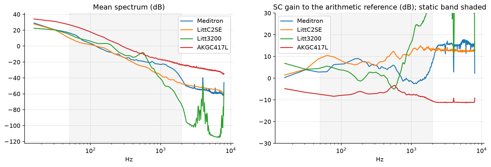
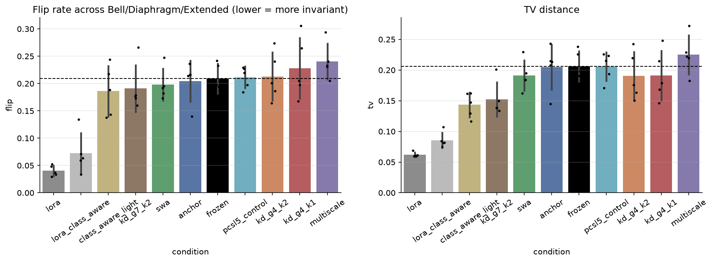

# AuscultTrust

Lung-sound classification that keeps its predictions and its split-conformal coverage when the stethoscope changes. Method: spectrum correction (SC) plus a conformal layer, on ICBHI with KAUH and phantom-replay checks.

AuscultTrust is the distilled student `kd_g4_k1`. The baseline is fine-tuned BEATs + PAFA without SC. Results: [report.md](report.md). Research prototype for sound classification; not a medical device, no diagnosis.

## Method


Devices differ in spectrum, so the same sound looks different to the model. SC estimates each device's mean spectrum from unlabelled clips and maps it to the training reference (gain in dB, static band 50-2000 Hz shaded):



## Results

Numbers and tags: [report.md](report.md). Figures are from `notebooks/`; dots are seeds, bars mean and SD.

**Official split, test Score, seeds 0-4.** `kd_g4_k1` is AuscultTrust, `anchor` the SC model it distils from; dashed line = anchor mean.


**Leave-one-device-out, Score per held-out device and macro, seeds 0-2.**


**KAUH, one recording through three filters.** Lower flip rate and TV distance mean more invariant. `kd_g4_k1` is not more invariant than the frozen baseline here; the SC gain is not shown on this measure.



## Quick start

| Platform | Steps |
| --- | --- |
| Linux, NVIDIA GPU | below; details in [docs/SETUP.md](docs/SETUP.md) sections 1-6 |
| Windows, GPU or CPU | [docs/SETUP.md](docs/SETUP.md) section 11 |
| Google Colab | [notebooks/colab_quickstart.ipynb](notebooks/colab_quickstart.ipynb), [docs/SETUP.md](docs/SETUP.md) section 12 |

```bash
uv venv .venv-train --python 3.10
uv pip sync --python .venv-train/bin/python --index-strategy unsafe-best-match --extra-index-url https://download.pytorch.org/whl/cu128 requirements-train.lock
bash scripts/download_data.sh && python scripts/prepare_data.py
.venv-train/bin/python -m pytest -q tests
export RUN_ID=my-run PYTHONPATH=. C=experiments/train
.venv-train/bin/python -m auscult_trust.training.main \
    --config $C/base.yaml,$C/encoder_beats.yaml,$C/grid/pafa_beats.yaml \
    --cell beats+ft+pafa --selection fixed --report_epochs 100 --seed 0
```

Final weights: GitHub Release `weights-final` ([DELIVERY.md](DELIVERY.md)).

## Guides

| Step | Where |
| --- | --- |
| Environment, data, checks | [docs/SETUP.md](docs/SETUP.md) sections 1-4 |
| Train one model (baseline, SC, LODO, other encoders) | SETUP section 5 |
| Inference, screening, KAUH, SC at inference | SETUP section 6 |
| Ensemble | SETUP section 7 |
| Distillation | SETUP section 8 |
| Run the app | SETUP section 9, [app/README.md](app/README.md) (deployment) |
| Sweeps and campaigns per stage (70-cell grid, LODO, ensembles, distillation, phantom replay) | [docs/REPRODUCE.md](docs/REPRODUCE.md) |
| Results by stage | [report.md](report.md) |
| Current state, open items | [docs/handoff/HANDOFF.md](docs/handoff/HANDOFF.md) |
| Docs index, registered study, plans, decisions | [docs/README.md](docs/README.md) |
| Working rules | [CLAUDE.md](CLAUDE.md) |

## Layout

| Path | Content |
| --- | --- |
| `auscult_trust/processing/` | Audio, ICBHI/KAUH, patient splits, spectrum correction |
| `auscult_trust/training/` | Training loop, encoders (AST, BEATs, HTS-AT, OPERA-CT, DASS), methods, distillation |
| `auscult_trust/inference/` | Frozen prediction, test-time SC |
| `auscult_trust/evaluation/` | Metrics, conformal, LODO, KAUH, screening, ensembles |
| `experiments/train/` | YAML recipes, composed left to right |
| `scripts/` | Grid, campaigns, frozen evaluation, ensembles, replay analysis |
| `notebooks/` | Analysis of finished outputs; `colab_quickstart.ipynb` runs the pipeline end to end |
| `api/`, `app/` | FastAPI service, web demo |
| `outputs/train/<run>/<cell>/<unit>/` | Reports, predictions; `outputs/index.csv` lists every unit |
| `checkpoints/train/<run>/<cell>/<unit>/` | Weights |

`../data` holds datasets; `third_party/` holds the vendored upstream code.
