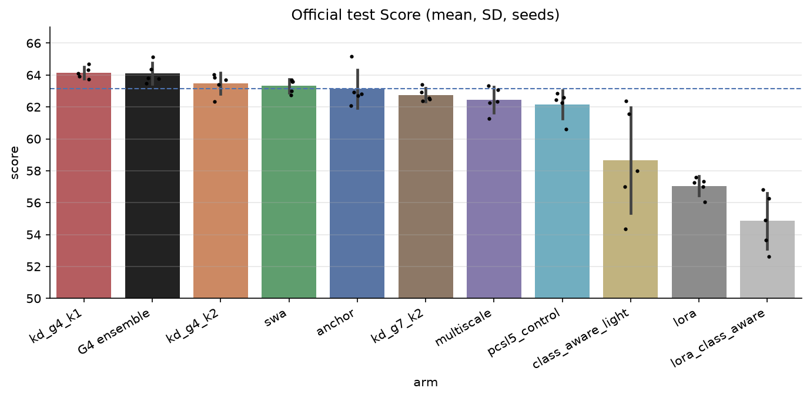
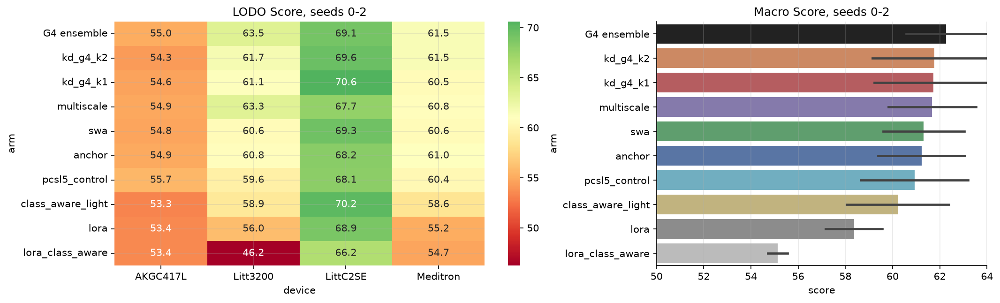

# AuscultTrust

Lung-sound classification that keeps its predictions and split-conformal coverage when the stethoscope changes. Spectrum correction (SC) plus a conformal layer, evaluated on ICBHI, with KAUH and phantom-replay checks.

AuscultTrust is the distilled student `kd_g4_k1` (BEATs + PAFA, static SC). The baseline is fine-tuned BEATs + PAFA without SC. Research prototype; not a medical device, no diagnosis.

Diagrams: [docs/ARCHITECTURE.md](docs/ARCHITECTURE.md). Results and claims: [report.md](report.md).

## Results

Dots are seeds, bars mean and SD. `anchor` is the SC model `kd_g4_k1` distils from.

| Official split, test Score (seeds 0-4) | LODO Score per held-out device (seeds 0-2) |
| --- | --- |
|  |  |


KAUH: lower flip rate and TV distance mean more invariant. `kd_g4_k1` is not more invariant than `frozen` (the 23/10 AuscultTrust); the difference is within seed spread.

## Quick start

| Platform | Steps |
| --- | --- |
| Linux, NVIDIA GPU | below, then [docs/SETUP.md](docs/SETUP.md) |
| Windows, GPU or CPU | [docs/SETUP.md](docs/SETUP.md) section 11 |
| Google Colab | [notebooks/colab_quickstart.ipynb](notebooks/colab_quickstart.ipynb), SETUP section 12 |

```bash
uv venv .venv-train --python 3.10
uv pip sync --python .venv-train/bin/python --index-strategy unsafe-best-match --extra-index-url https://download.pytorch.org/whl/cu128 requirements-train.lock
bash scripts/download_data.sh && python scripts/prepare_data.py
.venv-train/bin/python -m pytest -q tests
export RUN_ID=my-run PYTHONPATH=. C=experiments/train
.venv-train/bin/python -m auscult_trust.training.main \
    --config $C/base.yaml,$C/encoder_beats.yaml,$C/grid/pafa_beats.yaml \
    --cell beats+ft+pafa --selection fixed --report_epochs 100 --seed 0
```

Final weights: GitHub Release `weights-final` ([DELIVERY.md](DELIVERY.md)).

## Docs

| Need | Where |
| --- | --- |
| Environment, training, inference, ensembles, distillation, app | [docs/SETUP.md](docs/SETUP.md) |
| Commands per stage (grid, LODO, replay) | [docs/REPRODUCE.md](docs/REPRODUCE.md) |
| Web demo and deployment | [app/README.md](app/README.md) |
| Current state, open items | [docs/handoff/HANDOFF.md](docs/handoff/HANDOFF.md) |
| Registered study, plans, decisions | [docs/README.md](docs/README.md) |
| What ships | [DELIVERY.md](DELIVERY.md) |

## Layout

| Path | Content |
| --- | --- |
| `auscult_trust/` | `processing` (audio, splits, SC), `training`, `inference`, `evaluation` (metrics, conformal), `models` |
| `experiments/train/` | YAML recipes, composed left to right |
| `scripts/` | Grid, campaigns, frozen evaluation, ensembles |
| `notebooks/` | Analysis and Colab quickstart |
| `api/`, `app/` | FastAPI service, web demo |

Datasets live in `../data`; `third_party/` holds vendored upstream code.
