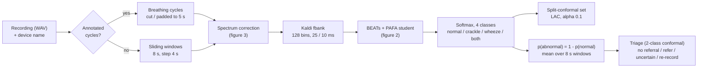
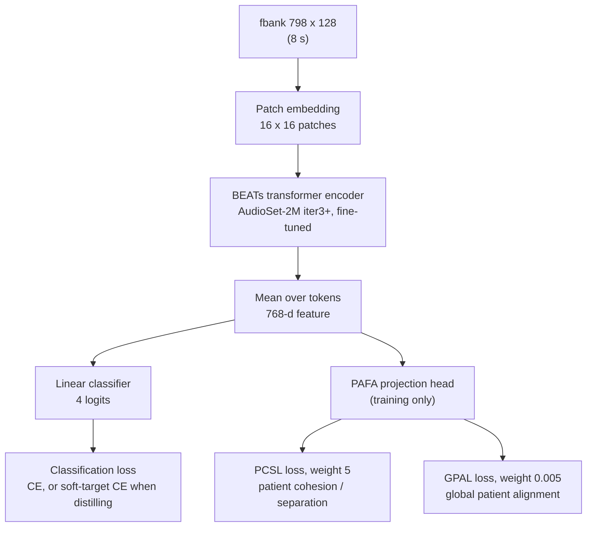
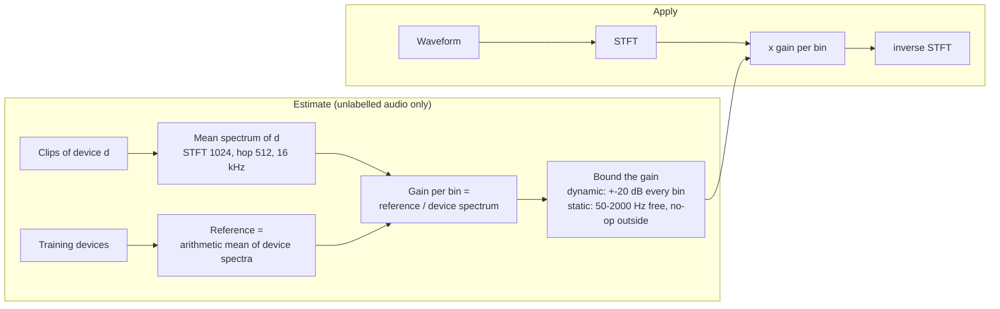
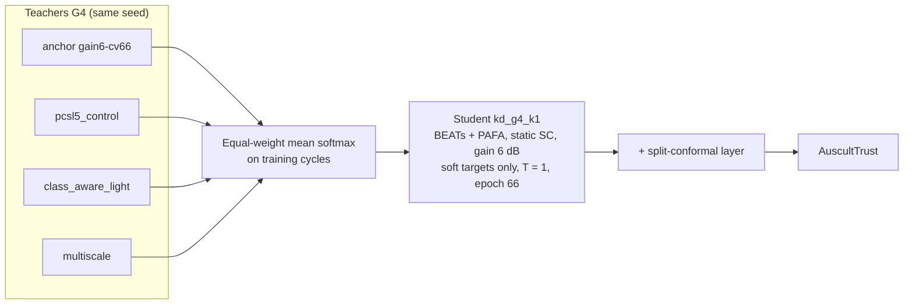

# Architecture

Diagrams of the final system. Sources: `auscult_trust/models/`, `auscult_trust/processing/correction.py`, `auscult_trust/evaluation/conformal.py`, `auscult_trust/training/methods/pafa.py`, `docs/decision-logs/2026-10-29-final-model-distilled.md`.

## 1. Inference pipeline

Cycle-level output (4 classes and sets) and recording-level screening (triage) share the same softmax.

## 2. Model: BEATs encoder with PAFA

At inference only the encoder and the linear classifier run. PAFA losses use patient identity and exist only at training time.

## 3. Spectrum correction (SC)

Known device: coefficients saved with the model. Unknown device (microphone take): estimated from the recording's own segments. Training adds a random smooth per-bin gain (6 dB SD) in the final recipe.

## 4. Distillation: how AuscultTrust is trained

The teachers are used at training time only; serving runs the single student.
